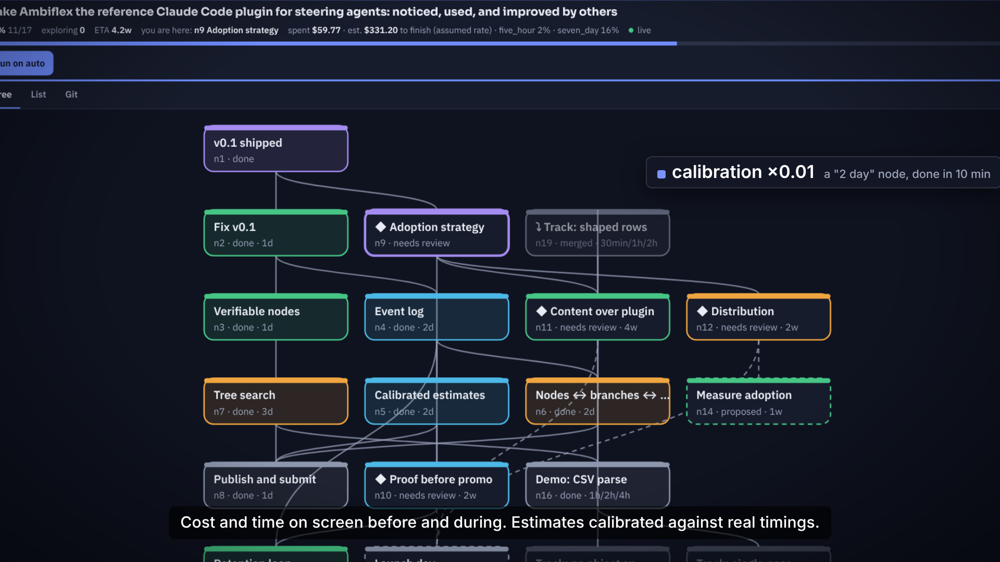

# My estimates were off by a factor of 100, in the wrong direction

*Draft 2, timings taken from commit timestamps on the auto-run branch, see docs/auto-run-report.md. Imade Ben Toum. Drafted by Claude from the session's own data (tree, log, commits); every number is traceable to the repository. Links to github.com/ImadeBenToumAI/ambiflex go live on launch day (the code is in the profile repository until then). To be edited and signed by me.*

Everyone who has managed a project knows the rule of thumb: whatever the engineer says, multiply by two. I built a plugin that measures the multiplier instead of guessing it, and the first number it gave me was 0.01.

## The setup

Ambiflex keeps a tree of the work Claude Code is doing. Each node carries an estimate, written the way a human writes one: `2d`, `1w`, or three-point `1h/2h/4h`. When the node starts, the plugin stamps the time; when its verification lands, it stamps the end. The ratio of actual to estimated, median over finished nodes, is the **calibration factor**, and the plugin multiplies every remaining estimate by it to produce an end date.

Simple. I expected a factor around 1.5. Project folklore says estimates run optimistic.

## What the tree recorded

Seven technical nodes finished in one evening. Their estimates were written for a human engineer: half a day to three days each, eleven days in total on the likely path. The wall-clock time Claude took, from the moment the node went `exploring` to the moment its tests were green:

| Node | Estimate | Actual | Ratio |
|---|---|---|---|
| Event log (append-only, union merge, replay) | 2d | 4 min | 0.004 |
| Calibrated estimates (PERT, end date) | 2d | 9 min, including a 6-minute detour on a `cd` bug | 0.009 |
| Nodes ↔ branches (worktree per agent) | 2d | 2 min | 0.002 |
| Tree search (3 parallel agents, prune, merge) | 3d | 7 min of build, then 3 agents × ~5 min in parallel | 0.008 |

Times are commit timestamps on the branch, from the node going `exploring` to its tests being green, with a human reading each result in between. A "day" is 8 hours. The median is under 0.01. The plan I had written for "eleven working days" took the plugin about 35 minutes of build time plus 20 minutes of agent exploration.

## The bug this caused

The first version of the calibration code refused ratios below 0.05. The reasoning was sound: a node whose timestamps are four minutes apart on a one-day estimate is usually a timestamp someone set by hand, not a measurement. So the code threw away the only honest number it had, reported "×1", and projected the remaining plan at **$15,600** of model time instead of a few hundred dollars. The projection was wrong because the code was too sure that nothing finishes a two-day task in ten minutes.

Now it accepts anything above 0.002, and rejects only timestamps seconds apart. The projection for what is left fell to a few hundred dollars, which is the right order of magnitude: the whole evening cost $57 of model time, three parallel agents included.

## Why the number matters

A factor of 0.01 does not mean estimates are useless. It means **the unit is wrong**. "Two days" was never a measure of the work; it was a measure of a human's calendar, with its meetings, context switches and sleep. The work itself, as a sequence of edits, tests and reads, is about an hour. When an agent does it, you see the hour.

Two consequences for anyone estimating work that an agent will do:

1. **Estimate the critical path, not the calendar.** The tree's end date is the longest chain of remaining estimates, times the factor. For the technical plan that was 11 days → about an hour. For the launch plan (articles, video, distribution) the factor is different, because those nodes wait on a human; the plugin will measure that too, once those nodes finish.
2. **The expensive thing is not the agent's time, it is the review.** With a 0.01 factor, the agent is idle most of the day waiting for someone to read "needs review". The bottleneck moved. Plan for it: batch the reviews, give the agent a judge it can run itself, and keep the queue of unreviewed nodes short.

## What I am changing in how I estimate

I still write estimates in human days, because that is the unit I can reason about. The plugin converts. What changed is that I now write three-point estimates (`1h/2h/4h`) so the end date carries a ±, and I look at the calibration line before I believe any ETA. Next week's number, after the articles and the video, will be the interesting one: that is where my own time is on the critical path.

The calibration code is `calibration()` in `hooks/tree.ts` at github.com/ImadeBenToumAI/ambiflex. The tree that produced these numbers is `.ambiflex/log.jsonl` in github.com/ImadeBenToumAI/ImadeBenToumAI, every event with its timestamp, and the per-node table is `docs/auto-run-report.md` there.
